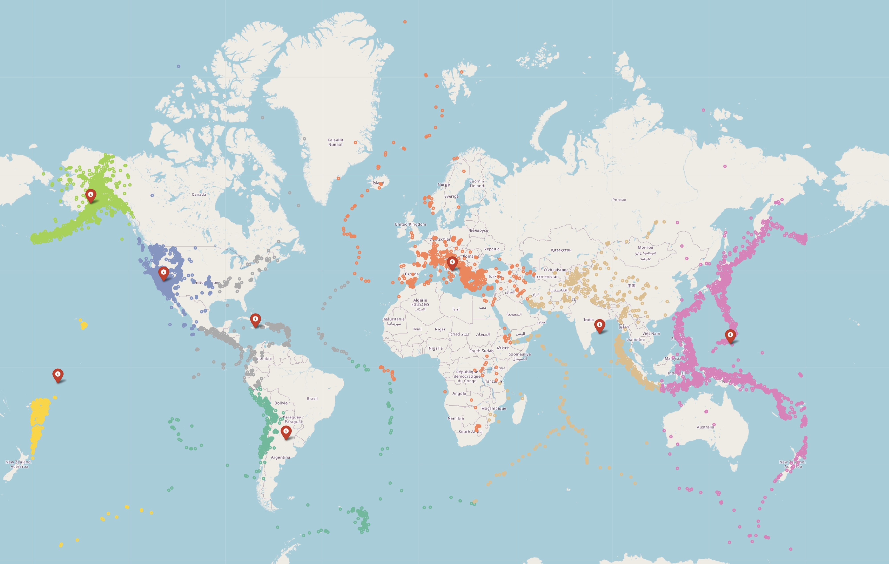
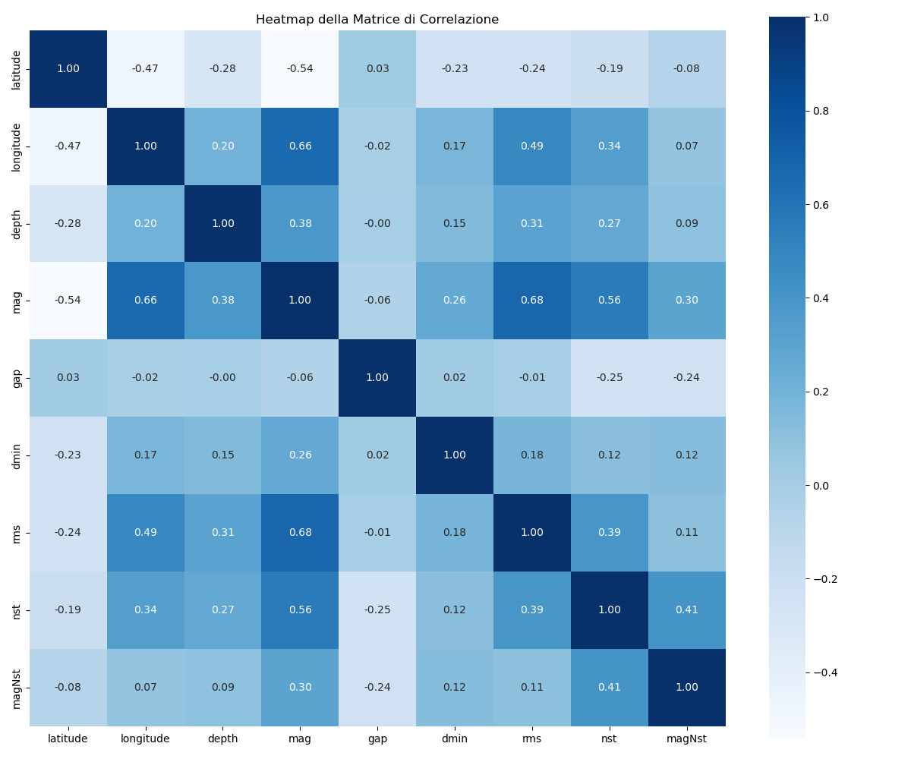
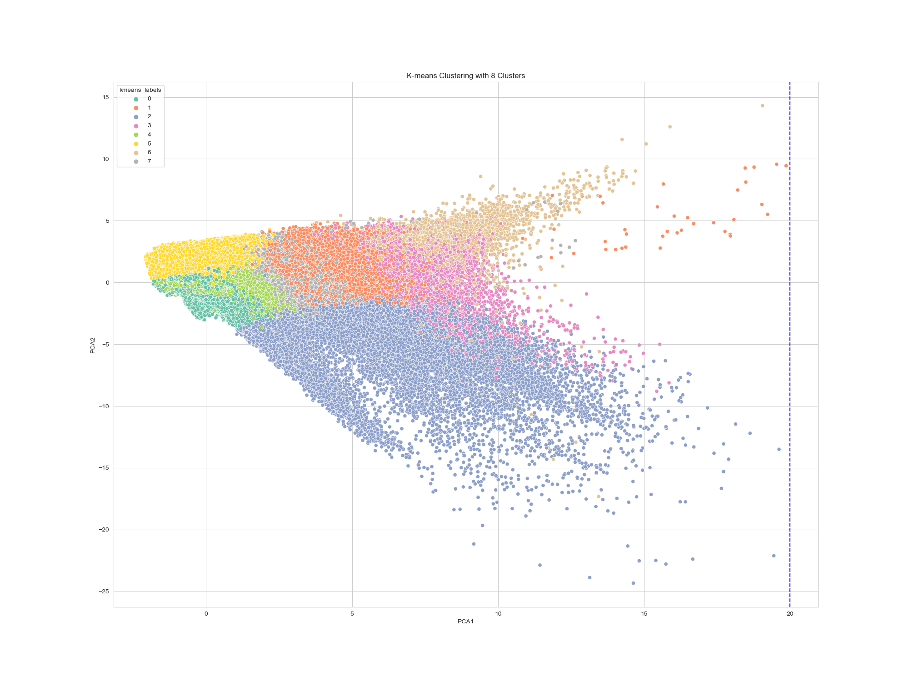
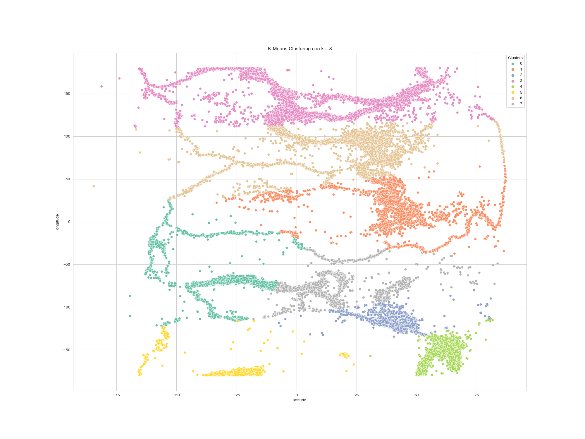
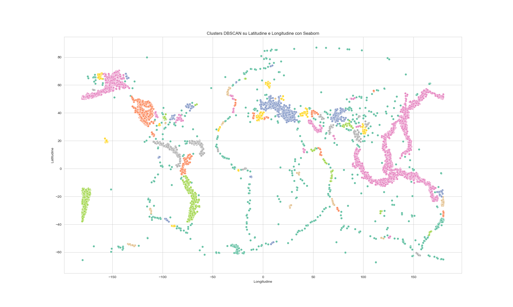
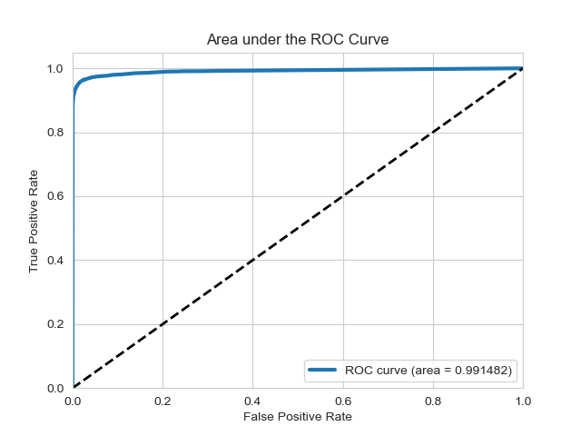

**Author:** Giuseppe Muschetta  
**University:** University of Pisa  
**Degree:** M.Sc. in Data Science & Business Informatics  
**Course:** Distributed Data Analysis and Mining  
**Academic year:** 2023–2024  
**Final grade:** 30/30 cum laude

---

<div align="center">

# Distributed Earthquake Analytics with Apache Spark

### 3.27 million seismic records · Model-based imputation · Multivariate clustering · Magnitude classification


[](images/clustering_kmeans/folium_world_map.jpg)

*Original Folium visualization from the technical report: sampled earthquake events coloured by eight geographical K-Means groups, with their centroids marked in red. [View the full-resolution map](images/clustering_kmeans/folium_world_map.jpg).*

[Read the technical report](report.pdf) · [Explore the maps](#geographical-clustering-and-interactive-maps) · [Explore the preparation pipeline](spark_understanding_preparation_regression.ipynb) · [Explore the classifiers](spark_classification.ipynb)

</div>

---

**From millions of seismic observations to interpretable patterns and evaluated models.** This project develops a complete data-mining workflow with **Apache Spark and PySpark**, connecting large-scale data preparation, regression-based missing-value imputation, unsupervised exploration, geographical visualization, and tree-based classification.

Starting with **3,272,774 historical seismic records**, the analysis produces a prepared catalogue of **2,607,588 earthquakes**, investigates their structure in both feature space and geographical coordinates, and examines magnitude classification under class imbalance. Spark DataFrames and MLlib carry the main preparation and modeling work; numerical summaries, selected samples, and model predictions support the visual analysis.

Developed by **Giuseppe Muschetta** for the **master's-level examination** in *Distributed Data Analysis and Mining*, within the **M.Sc. in Data Science & Business Informatics at the University of Pisa**, the project received **30/30 cum laude**.

## Project highlights

- **Millions of observations, one connected workflow:** four notebooks cover understanding, preparation, exploratory clustering, geographical clustering, and classification.
- **Model-based data preparation:** retain informative attributes with substantial missingness by combining mean imputation, linear regression, and decision-tree regression.
- **Two complementary clustering perspectives:** nine-feature K-Means reveals multivariate profiles; latitude–longitude K-Means organizes the geographical distribution.
- **Exploration that informs preprocessing:** a two-component PCA projection exposes 32 extreme observations without applying blanket univariate trimming across the global catalogue.
- **Evaluation beyond accuracy:** ROC curves, weighted metrics, confusion matrices, and decision-threshold analysis make the minority-class trade-off explicit.
- **Interpretable evidence:** cluster-level statistics, selected figures, interactive Folium maps, and a 22-page technical report document the analytical decisions.

## The dataset

The source is the [Earthquakes dataset on Kaggle](https://www.kaggle.com/datasets/danielpe/earthquakes), linked in both the preparation notebook and the report. The saved notebook statistics place the observations between **January 1970 and March 2019**.

| Stage | Records | Description |
|:---|---:|:---|
| Original catalogue | **3,272,774** | 23 columns, including earthquake and other seismic-event records |
| After deduplication | **3,256,955** | Duplicate rows removed after the initial column selection |
| Prepared earthquake catalogue | **2,607,588** | 13 retained columns, with missing values imputed |
| After exploratory outlier filtering | **2,607,556** | 32 extreme observations excluded; multivariate cluster labels retained for classification |

The retained information includes event coordinates, depth, magnitude, magnitude scale, station counts, recording-quality attributes, timestamps, and location descriptions. Raw and prepared dataset files are external to this repository; the notebooks and report preserve the analysis and its recorded results.

## Data engineering and regression-based imputation

The [understanding and preparation notebook](spark_understanding_preparation_regression.ipynb) begins with schema inspection, missing-value counts, numerical summaries, distributions, and Spark-computed Pearson correlations. It then removes duplicates, restricts the population to earthquake events with positive depth and magnitude, handles missingness in essential fields, and consolidates magnitude-scale categories into `ml`, `md`, and `other`.

A key decision is to **preserve informative variables instead of discarding them because of missingness**. In the original catalogue, missing values affect approximately **41.15% of `dmin`**, **30.22% of `magNst`**, **26.94% of `nst`**, and **25.62% of `gap`**.

| Attribute | Implemented treatment | Modeling details |
|:---|:---|:---|
| `dmin`, `gap` | Mean imputation | Spark ML `Imputer` |
| `nst` | Linear-regression imputation | `VectorAssembler` → `StandardScaler` → `LinearRegression` |
| `magNst` | Decision-tree-regression imputation | `VectorAssembler` → `DecisionTreeRegressor` |

The regression models use **latitude, longitude, depth, magnitude, and RMS residuals** as predictors. Existing observed values are preserved; predictions replace missing values. The saved final inspection reports **no remaining null values in the retained columns**.



*Post-imputation correlation structure, computed with Spark and visualized as a heatmap.*

## Multivariate exploration: K-Means and PCA

The [exploratory clustering notebook](spark_clustering_exploration_kmeans.ipynb) combines nine numerical attributes:

```text
latitude · longitude · depth · mag · nst · magNst · gap · dmin · rms
```

`VectorAssembler` and `StandardScaler` prepare the feature vectors for Spark **K-Means**, using **k-means|| initialization** and seed 42. The notebook explores different cluster counts through SSE and silhouette curves, then selects **eight groups** for interpretation.

**PCA is applied after clustering to provide a two-dimensional view of the nine-feature space.** This projection identifies 32 extreme observations, excluded by the notebook's `pca_1 <= 20` filter. The existing cluster assignments are retained after filtering.



*K-Means uses the nine scaled attributes; PCA supplies the visual projection. Colours identify the eight exploratory groups.*

Cluster-level counts, means, standard deviations, minima, and maxima support interpretation. Examples from the recorded statistics include:

| Multivariate group | Records | Distinctive profile |
|:---|---:|:---|
| Cluster 0 | **1,228,039** | Shallow, lower-magnitude events: mean depth **6.08 km**, mean magnitude **1.31** |
| Cluster 2 | **38,944** | High station coverage: mean `nst` **131.69**, mean `magNst` **112.52** |
| Cluster 3 | **25,368** | Deep events: mean depth **498.41 km**, observed range **242.41–735.8 km** |
| Cluster 6 | **4,612** | Unusually large nearest-station distance: mean `dmin` **20.91** in the catalogue's units |

These profiles show how similar geographical observations can differ in depth, magnitude, station coverage, and recording characteristics. The eight-group solution is an exploratory choice of granularity, interpreted through its statistics and visual structure.

## Geographical clustering and interactive maps

The [geographical notebook](spark_clustering_geographical.ipynb) takes a complementary approach: K-Means uses **latitude and longitude in their original coordinate scale**, with **eight clusters** and seed 1. SSE and silhouette curves guide the exploration; the opening figure shows the resulting geographical structure.

The largest geographical group contains **1,655,188 events**, approximately **63.48%** of the prepared catalogue, concentrated in the western United States. Other groups distinguish areas including Alaska, the western Pacific, Europe, South America, and New Zealand. These proportions describe this catalogue and its recording coverage.

The geographical labels are separate from the nine-feature labels used in multivariate exploration. The coordinate-based analysis uses Euclidean distance in degrees.

### Eight geographical clusters across the earthquake catalogue

The K-Means view below makes the spatial structure visible through the earthquake coordinates themselves. **Eight colours distinguish the geographical groups**, revealing dense concentrations, extended bands, and differences in their spatial extent across the prepared catalogue.

[](images/clustering_kmeans/kmeans_clusters.png)

*Original K-Means visualization on a sample of **782,819 earthquake records**. Latitude is on the horizontal axis and longitude on the vertical axis. [Inspect the full-resolution figure](images/clustering_kmeans/kmeans_clusters.png).*

### A complementary density-based view

The supplementary DBSCAN visualization provides another view of the geographical patterns, displayed with longitude on the horizontal axis and latitude on the vertical axis.

[](images/clustering_dbscan/clusters_DBSCAN.png)

*Saved density-based clustering visualization from the project. [Inspect the full-resolution figure](images/clustering_dbscan/clusters_DBSCAN.png).*

### Explore the Folium maps

The interactive HTML artifacts complement these static previews with navigable world maps. The K-Means map includes cluster popups and centroid markers; the supplementary maps show the density-based visualization and its overlay with the K-Means centroids.

| Map artifact | Contents |
|:---|:---|
| [K-Means map](images/clustering_kmeans/world_map_combined.html) | 30,000 sampled events, cluster popups, and eight centroids |
| [Supplementary DBSCAN visualization](images/clustering_dbscan/world_map_DBSCANed.html) | Density-based clustering visualization with 50,268 plotted events |
| [DBSCAN visualization with K-Means centroids](images/clustering_dbscan/world_map_DBSCANed_KMEANSed.html) | The same plotted events with eight K-Means centroids overlaid |

Download an HTML artifact and open it in a browser to explore the map. Map tiles and supporting libraries require an internet connection. The supplementary DBSCAN artifacts are included as visual outputs; their generation code is not included in the supplied notebooks.

## Magnitude classification at scale

The [classification notebook](spark_classification.ipynb) defines a binary target directly from recorded magnitude:

| Class | Definition | Records | Share |
|:---|:---|---:|---:|
| 0 | `mag < 3` | **2,148,488** | **82.39%** |
| 1 | `mag >= 3` | **459,068** | **17.61%** |

The models classify the magnitude category of historical records. Numerical attributes, encoded magnitude-scale categories, timestamps, and multivariate cluster labels produce a **19-feature vector**. A seeded **80/20 random split** yields a test set of **521,052 records**; the saved experiments use **four-fold cross-validation** with ROC-AUC evaluation.

| Model | Configuration | Accuracy | ROC-AUC | Weighted F1 |
|:---|:---|---:|---:|---:|
| Decision Tree | Depth 5, Gini, minimum 3 instances per node | **97.86%** | **0.9694** | **0.9782** |
| Random Forest | 10 trees, depth 10, minimum 50 instances per node | **98.35%** | **0.9915** | **0.9832** |

*Results recorded in the original classification notebook and report. F1 is weighted across classes.*

**Evaluation context:** these are retrospective results from the original academic workflow. Imputation and feature preparation precede the train/test split, and the cluster-label feature comes from K-Means fitted with magnitude among its inputs. Magnitude therefore contributes indirectly to the classifier's features; the reported scores describe this exploratory setup and do not establish independent forecasting performance.



### The decision threshold changes what the model misses

The notebook goes beyond headline accuracy by comparing the standard decision threshold with **0.3** for the positive class.

| Random Forest operating point | True negatives | False positives | False negatives | True positives | Positive-class recall |
|:---|---:|---:|---:|---:|---:|
| Standard threshold | 428,286 | 1,183 | **7,425** | 84,158 | **91.89%** |
| Threshold 0.3 | 426,011 | 3,458 | **5,368** | 86,215 | **94.14%** |

On the recorded test set, lowering the threshold reduces false negatives by **27.70%**, while increasing false positives. This makes the **recall–false-positive trade-off under class imbalance** explicit. The lower threshold is an analyzed operating point, evaluated on that same test set.

## Reading the repository

| File | What to inspect |
|:---|:---|
| [Technical report](report.pdf) | The complete narrative: data understanding, preparation, cluster interpretation, and classification results |
| [Understanding, preparation, and regression](spark_understanding_preparation_regression.ipynb) | DataFrame operations, missing-value analysis, categorical consolidation, and imputation pipelines |
| [Multivariate K-Means exploration](spark_clustering_exploration_kmeans.ipynb) | Feature scaling, cluster-count exploration, PCA, outlier filtering, and group statistics |
| [Geographical K-Means](spark_clustering_geographical.ipynb) | Coordinate-based clustering, sampled plots, and Folium map construction |
| [Magnitude classification](spark_classification.ipynb) | Feature encoding, decision trees, random forests, ROC evaluation, and threshold analysis |

```text
.
├── README.md
├── report.pdf
├── spark_understanding_preparation_regression.ipynb
├── spark_clustering_exploration_kmeans.ipynb
├── spark_clustering_geographical.ipynb
├── spark_classification.ipynb
└── images/
    ├── understanding/
    ├── clustering_exploration_kmeans/
    ├── clustering_kmeans/            # Plots, Folium HTML, and folium_world_map.jpg
    ├── clustering_dbscan/
    └── classification/
```

## Technical environment and data paths

The saved notebook outputs identify **Python 3.11** and **Apache Spark 3.4.1**. Spark sessions use **`local[*]`**, enabling parallel execution across the available local cores. The project demonstrates Spark's DataFrame and MLlib programming model on millions of records; the supplied results come from local execution.

Supporting libraries include **Pandas, NumPy, Matplotlib, Seaborn, Folium, Graphviz**, and **scikit-learn metrics** for plotting saved classifier predictions. The notebook paths describe this data flow:

```text
dataset/earthquakes.csv
    → preparation and regression-based imputation
dataset/earthquakes_prepared.csv
    → multivariate K-Means and PCA-based filtering
dataset/earthquakes_prepared_outliered_kmeans_labeled.csv
    → magnitude classification
```

The prepared catalogue also feeds geographical clustering. Spark CSV export produces a directory containing a data part and metadata; the downstream notebooks expect the named CSV files shown above.

## Skills demonstrated

**Spark DataFrames and MLlib · Data profiling · Missing-data strategies · Regression-based imputation · Feature engineering · Spark pipelines · K-Means · PCA · Geographical analytics · Ensemble learning · Cross-validation · Imbalanced classification · ROC analysis · Decision-threshold trade-offs · Technical reporting**
